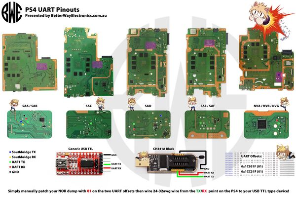

# PS4 UART Logger

Capture and monitor UART serial output from a jailbroken PS4 using an Arduino CH340 as a USB-to-serial passthrough.

Tested on firmware **12.02**.

## Requirements

- Jailbreakable PlayStation 4 (any model)
- Arduino with CH340 USB-to-serial chip
- Soldering iron + wires
- macOS with Python 3 and `pyserial` (`pip install pyserial`)

## Setup

### 1. Solder UART on PS4

Follow the soldering guide for your PS4 model:

**[PlayStation 4 UART Pinout Guide](https://repair.wiki/w/Playstation_4_Fault_finding_with_UART#Connect_to_UART)**



### 2. Load the UART Payload

Using [Payload Guest](https://github.com/ArabPixel/PSFree-Enhanced) or any other payload sender, load the **permanent UART payload**.

You can get it from:
- This repo: [`ps4-permanent-uart.bin`](ps4-permanent-uart.bin)
- Or from [PSFree-Enhanced payloads](https://github.com/ArabPixel/PSFree-Enhanced/tree/main/includes/payloads)

### 3. Connect Arduino CH340

Wire the Arduino as a USB-to-serial passthrough:

| From | To |
|---|---|
| PS4 TX | Arduino **TX** (pin 1) |
| PS4 GND | Arduino **GND** |
| Arduino **RST** | Arduino **GND** |

> Grounding RST disables the ATmega chip, making the CH340 act as a direct USB-to-serial converter.

Plug the Arduino into your Mac via USB.

### 4. Run the Logger

```bash
pip install pyserial

python3 ps4uart.py start    # start capturing in background
python3 ps4uart.py live     # watch output in real-time
```

### Commands

| Command | Description |
|---|---|
| `python3 ps4uart.py start` | Start capturing UART in the background |
| `python3 ps4uart.py stop` | Stop the capture |
| `python3 ps4uart.py live` | Tail the log in real-time (Ctrl+C to stop watching) |
| `python3 ps4uart.py status` | Check if capture is running and show stats |
| `python3 ps4uart.py dump` | Print the full current log |
| `python3 ps4uart.py list` | List all saved log files |
| `python3 ps4uart.py clean` | Remove all log files |

Logs are saved to `logs/` with timestamps. The logger auto-reconnects if the serial connection drops.

## Resources

- [PS4 UART Fault Finding Guide](https://repair.wiki/w/Playstation_4_Fault_finding_with_UART#Connect_to_UART)
- [PSFree-Enhanced Payloads](https://github.com/ArabPixel/PSFree-Enhanced/tree/main/includes/payloads)
- [Video Guide](https://youtu.be/5gkQJJbQaeU)
